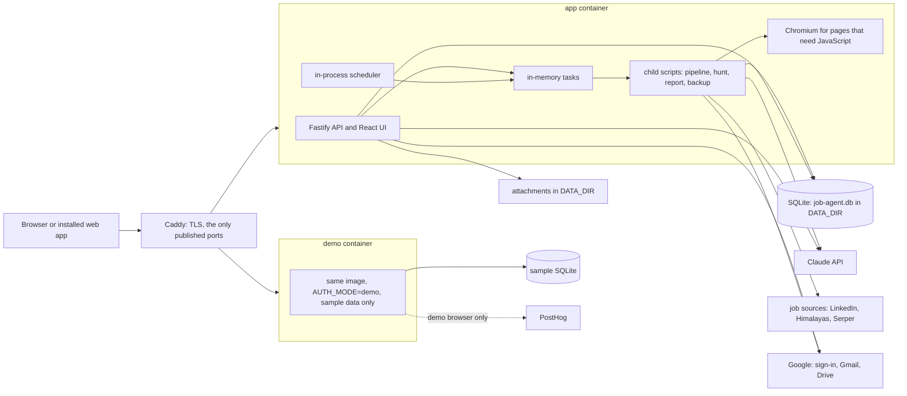

# Current architecture (v2-final)

How the system runs at the `v2-final` tag, before the v3 work in [docs/v3/PLAN.md](../v3/PLAN.md). The details behind each
box are in [CLAUDE.md](../../CLAUDE.md).

## Running pieces

- **Caddy** terminates TLS and is the only service with published ports. It keeps no access log.
- **The app container** is one Node process:
  - Fastify routes with JSON schemas (`/api/openapi.json`) and the built React UI;
  - the in-process scheduler (`server/scheduler.js`, set in `.env`);
  - long actions as in-memory tasks (`server/tasks.js`), lost on restart;
  - the pipeline and other scripts as child processes, one pipeline at a time across the app;
  - Chromium for pages that need JavaScript.
- **The demo container:** the same image with `AUTH_MODE=demo`. It has its own sample database, no secrets, and no Claude.
- **Storage:** one SQLite file through synchronous `better-sqlite3`, plus attachment files.
  - Every user table carries `user_id`, and queries are scoped by `db/scope.js`.

## Outside services

- **Claude:** scoring, letters, meeting prep, the inbox classifier, Help, and drafts. Each call goes on a traced run, against the paying user's cap.
- **Google:**
  - sign-in;
  - the owner's Gmail (inbox reading and labels; account and report email);
  - Drive (letters, preps, encrypted backups).
- **Job sources:** LinkedIn and Himalayas. Serper is used for the owner's searches only.
- **PostHog:** counts from the demo page only. The signed-in app sends nothing to it.

## Deploy path

1. A push to main runs CI: tests in two time zones, npm audit, the web build, and the personal data scan.
2. Deploy builds the image, scans it with Trivy, and publishes it to GHCR.
3. Over SSH, `deploy/deploy.sh` then:
   - checks for pending migrations;
   - backs up first when there are any;
   - starts the new image, checks health, and rolls back on failure.

## Data and backups

- `openJobStore` copies the database before any migration changes it, and keeps the newest 5 copies.
- **Nightly encrypted backup** (`tools/backup`): an integrity-checked snapshot plus settings and attachments, gzipped and AES-256-GCM encrypted, then uploaded to the owner's Drive. It keeps 7 nightly, 3 weekly, and 1 monthly.
- A restore test runs monthly.

## Limits v3 addresses

- A single writer and a single host.
- Synchronous database calls everywhere.
- Tasks lost on restart.
- One process for web, AI, browser, and email work.
- No infrastructure as code.

See section 2 of the plan.
