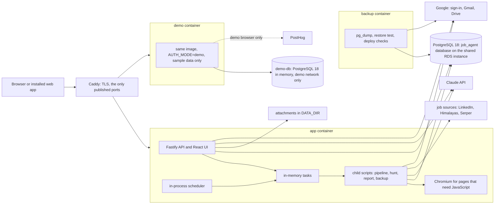

# Current architecture

How the system runs, kept current through v3 Phase 5 (production on PostgreSQL). The `v2-final` tag marks where v3 began
([docs/v3/PLAN.md](../v3/PLAN.md)). The details behind each box are in [CLAUDE.md](../../CLAUDE.md).

## Running pieces

- **Caddy** terminates TLS and is the only service with published ports. It keeps no access log.
- **The app container** is one Node process:
  - Fastify routes with JSON schemas (`/api/openapi.json`) and the built React UI;
  - the in-process scheduler (`server/scheduler.ts`, set in `.env`);
  - long actions as in-memory tasks (`server/tasks.ts`), lost on restart;
  - the pipeline and other scripts as child processes, one pipeline at a time across the app;
  - Chromium for pages that need JavaScript.
- **The demo container:** the same image with `AUTH_MODE=demo`. It has no secrets and no Claude. Its sample data lives in its own PostgreSQL container (`demo-db`, since v3 Phase 4), in memory, on a private network only the demo joins; a restart of either rebuilds the data.
- **The server** (since v3 Phase 5, decision 0007): an EC2 instance built by `infra/` (Terraform) inside Health-Review's network, with settings from SSM Parameter Store (`env-from-ssm.sh`). Before that, a Lightsail server ran the app on SQLite.
- **The backup container:** the same image plus PostgreSQL 18's programs. It runs the nightly backup and the monthly restore test, and `deploy.sh`'s checked dump and migration. It alone holds the owner and backup logins.
- **Storage:** the `job_agent` database on Health-Review's RDS instance (PostgreSQL 18, private, encrypted), reached with the database's certificate checked, plus attachment files on the server's encrypted disk. Three logins: the owner runs migrations at deploy, the app only reads and writes rows, and the backup login only reads. Row-level security keeps each user's rows to that user. Local installs can still choose SQLite (decision 0006).
  - Since v3 Phase 3, every call goes through the async data layer (`db/engine`): statements return promises, and
    transactions are serialized so nothing from another request lands inside one. `better-sqlite3` sits underneath
    it and the migrations only.
  - Every user table carries `user_id`, and the engine binds `@uid` to the user of the current request or job
    (`db/scope.ts`).

## Outside services

- **Claude:** scoring, letters, meeting prep, the inbox classifier, Help, and drafts. Each call goes on a traced run, against the paying user's cap.
- **Google:**
  - sign-in;
  - the owner's Gmail (inbox reading and labels; account and report email);
  - Drive (letters, preps, encrypted backups).
- **Job sources:** LinkedIn and Himalayas. Serper is used for the owner's searches only.
- **PostHog:** counts from the demo page only. The signed-in app sends nothing to it.

## Deploy path

1. A push to main runs CI: tests in two time zones, npm audit, the web build, and the personal data scan.
2. Deploy builds the image, scans it with Trivy, and publishes it to GHCR.
3. Over SSH, `deploy/deploy.sh` then:
   - checks for pending migrations;
   - backs up first when there are any;
   - starts the new image, checks health, and rolls back on failure.

## Data and backups

- **Before every deploy that migrates,** the backup container keeps a `pg_dump` checked in a throwaway cluster, tries the migrations on it first, and restores it if the deploy fails.
- **Nightly encrypted backup** (`tools/backup`): a `pg_dump` checked by restoring it into a throwaway cluster, plus settings and attachments, gzipped and AES-256-GCM encrypted, then uploaded to the owner's Drive. It keeps 7 nightly, 3 weekly, and 1 monthly. RDS also keeps 7 days of its own point-in-time backups for the whole shared instance.
- A restore test runs monthly, into a throwaway cluster, comparing row counts.

## Limits v3 addresses

- A single writer and a single host. (Phase 5 moved the database to RDS; one app server remains.)
- Synchronous database calls everywhere. (Done in Phase 3.)
- Tasks lost on restart. (Phase 6.)
- One process for web, AI, browser, and email work. (Phase 6.)
- No infrastructure as code. (Done in Phase 5: `infra/`.)

See section 2 of the plan.
