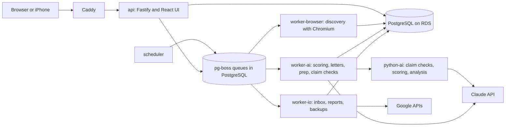

# Job-Agent v3 Implementation Plan

Status: proposed, revision 2, 2026-11-02. Target location in the repo: `docs/v3/PLAN.md`.

This repo is public. This plan contains no personal data, and every change made from it must keep that true.

## 1. How Claude Code should use this plan

Read `CLAUDE.md` first. Its hard rules still apply and win over this plan if the two conflict. Then work one phase at a time:

1. Start in plan mode and propose the concrete steps for the current phase only. Wait for the owner's approval.
2. Work in small pull requests. `main` stays deployable after every merge.
3. Finish a phase only when its Done When list passes, then stop and report results.
4. Update `CLAUDE.md`, `README.md`, `PRIVACY.md`, `EVALS.md`, and the help guides in the same pull request as any change that makes them untrue.
5. Record each significant decision as a short record in `docs/architecture/decisions/`.

Stop and ask the owner before you:

- Spend money, including paid eval runs and new AWS resources
- Touch production data, production settings, DNS, or the Lightsail server
- Run a cutover or any step that cannot be undone
- Change `Agent-Core` in a way that affects `Health-Review`, or change `Health-Review` at all
- Add an outside service, because `PRIVACY.md` must change with it
- Change a prompt, model, schema, or scoring threshold without the eval evidence `CLAUDE.md` requires

Checks for every pull request, added to as phases create them:

```
npm test
npm run web:build
npm run check:personal -- --all
npm run check:security
npm run typecheck      # from Phase 2
npm run lint           # from Phase 2
```

## 2. Starting point

Verified from the code on 2026-11-02 at commit `c6bb86f`. All 428 tests passed in a clean clone.

The app is further along than a typical v2, so this plan builds on what exists.

**Already built. Do not rebuild.**

| Area | What exists |
|---|---|
| Safety net | 428 tests, CI in two time zones, npm audit, CodeQL, Trivy image scans, weekly OWASP ZAP on the demo, personal data scan, pre-commit hook, Dependabot |
| Deployment | Docker, GitHub Actions to GHCR, `deploy.sh` with health checks, rollback, and pre-migration backups, Caddy on Lightsail |
| Accounts | Google sign-in, owner and admin roles, approval flow, pause, data export, account deletion, per-user AI keys and budget caps |
| Isolation | `user_id` on every user table, `db/scope.js`, `test/user-scope.test.js`, `test/user-isolation.test.js` |
| API | Fastify with JSON schemas and `/api/openapi.json` |
| AI controls | `createJobClaude`, traced runs, per-user cost caps, editable and versioned prompts |
| Evals | Inbox and scoring evals with results in `EVALS.md` |
| Interview prep | `agents/hunt/prep.js`, streamed and researched, with Word download |
| Outcome data | `server/funnel.js`, `status_history`, linked emails, `decision_log`, score history with prompt version |
| Backups | Encrypted Drive backup, restore test, monthly schedule |
| Public demo | Read-only sample data, with no secrets |

**What v3 actually needs to change.**

| Gap | Today | Why it matters |
|---|---|---|
| Language | JavaScript, about 22,000 lines plus 9,200 lines of tests, no type checking | Largest refactors are unsafe without types |
| Database | SQLite through synchronous `better-sqlite3`, 303 `prepare` calls in 62 files | One writer, one host, blocks splitting into services |
| Work execution | In-memory task map (`server/tasks.js`), child processes, one pipeline at a time | A restart loses tasks, no priority, no fairness, no retries |
| Scheduling | `server/scheduler.js` inside the web process, set in `.env` | Cannot scale or be managed in the admin screen |
| Deployment shape | One process does web, AI, Chromium, and email | Cannot show or tune separate workloads |
| Infrastructure | Server set up by hand | No infrastructure as code |
| Letter accuracy | Regex rules from config and a word limit | Cannot catch an invented or wrong fact in general |
| Scoring feedback | Outcomes are stored, but not compared with scores | The system cannot learn which scores predicted results |

## 3. Decisions

| Decision | Choice | Why |
|---|---|---|
| Repository | Keep this repo. Tag `v2-final`. v3 ships as `v3.0.0` | The work is an incremental migration on a running system. History, issues, CI, secrets, deploy keys, and the image name stay intact, and the visible evolution is part of the portfolio story |
| Language | TypeScript for the platform | Incremental path from this code, shared types from database to UI |
| Second language | Python for a stateless AI service, called by TypeScript workers | Real AI work in Python, with a clean boundary: it holds no database credentials and owns no user data |
| TypeScript runtime | Node type stripping, erasable syntax only | No build step on the server. Requires Node 22.18 or newer |
| Database | PostgreSQL on RDS | Managed backups, concurrent writers, row level security, queue in the same database |
| Query layer | Keep hand-written SQL behind a typed adapter | Avoids rewriting 303 queries, which would combine two risky changes. New code may adopt a typed query builder later through a decision record |
| Queue | pg-boss behind a `JobQueue` interface | No separate broker to run or pay for. Supports priority, retries, dead letters, per-group concurrency, and changing a waiting job. Replaces the earlier RabbitMQ and Redis plan |
| Architecture | Modular monolith, then separate workers | Services split where workloads truly differ. Honest label: a modular platform with independently deployed workers sharing one database |
| Cloud | Stay on AWS with Lightsail for compute at first | Already running. RDS connects through VPC peering |
| iPhone | SwiftUI, last | Depends on token authentication and a stable API. The installable web app covers the gap |
| Health-Review | Out of scope, but do not block it | It shares `Agent-Core`, and its sync and scheduling needs look similar |

### Order changes from earlier discussions

- **TypeScript type checking comes before PostgreSQL.** Moving from synchronous to asynchronous database calls is the riskiest change, and the compiler plus `no-floating-promises` is what catches a missed `await`.
- **The async change ships on SQLite first.** That separates "calls became async" from "the engine changed", so a failure has one possible cause.
- **The safety net, authentication, and interview prep phases are removed**, because they already exist.
- **Outcome tracking becomes outcome analysis**, because the data is already being collected.
- **The Python service is an AI service for selected non-streaming tasks, not a gateway for every Claude call.** TypeScript keeps users, budgets, the queue, and the database. Streamed meeting prep stays in TypeScript at first, since a network hop in front of it adds risk for little gain.

## 4. Target architecture



Rules for the target state:

- The API never calls a worker directly. It records a task and enqueues a job.
- Job payloads hold IDs only, never prompt text, email content, or knowledge doc text.
- Priority only matters between jobs competing for the same worker pool. Pools exist because their resources differ.
- Each service gets only the secrets it needs, and its own database role.
- The public demo never receives production credentials.
- The Python AI service is stateless, has no database access, and is reachable only from the AI worker.

## 5. Phases

Sizes are rough: S is days, M is about one to two weeks, L is two to four weeks, part time, with Claude Code. Each phase leaves a working product, so the owner can stop after any of them.

| # | Phase | Size | Ships to production |
|---|---|---|---|
| 0 | Baseline and v3 setup | S | Docs only |
| 1 | Letter claim verification | S to M | Yes |
| 2 | TypeScript foundation | M | Yes |
| 3 | Async data layer on SQLite | L | Yes |
| 4 | PostgreSQL support | L | Local and CI only |
| 5 | RDS and cutover | M | Yes |
| 6 | Durable job system and admin screen | L | Yes |
| 7 | Modular split and observability | L | Yes |
| 8 | Outcome analysis | S to M | Yes |
| 9 | Python AI service | M to L | Yes |
| 10 | Public architecture page | S | Yes |
| 11 | iPhone app | L | TestFlight |

### Phase 0: Baseline and v3 setup

Goal: a clear starting line, with nothing about the product changed.

1. Tag the current `main` as `v2-final`.
2. Add this plan as `docs/v3/PLAN.md`, and create one GitHub milestone per phase.
3. Add `docs/architecture/current-state.md` with a diagram of the system as it runs today.
4. Add decision records for the choices in section 3, starting with repository, TypeScript, PostgreSQL, and the queue.
5. Add `npm run report:baseline`, which prints counts only: rows per table, database size, attachment size, and Claude spend by month. It runs locally and its output stays out of the repo.
6. Have the owner run the baseline in production, and note the Lightsail plan and memory use for later sizing.
7. Add a data quality count for outcomes: applications with no `applied_on`, stale statuses, and how many have linked emails. Counts only.

Done when:
- [ ] Tag and milestones exist
- [ ] Current architecture and decision records are merged
- [ ] The owner has private baseline numbers

### Phase 1: Letter claim verification

Goal: catch invented or wrong facts in a cover letter before the user sends it. This is first because it helps active use immediately.

Today `agents/hunt/generate.js` calls `checkCoverLetter` with `config.coverLetterChecks`, which are regex rules. Keep them, and add a second check.

1. Add `agents/hunt/verify-letter.js`. It takes the letter, the knowledge doc, and the chosen resume, and returns each factual claim about the candidate with:
   - `verdict`: `supported`, `unsupported`, or `contradicted`
   - `evidence`: the short supporting passage, or empty
   - `kind`: employer, title, date, number, credential, or other
2. Add the prompt `agents/hunt/prompts/verify-letter.md` to `PROMPTS` in `agents/prompts.js`, with an output schema in the repo. Treat posting text as untrusted data. Keep to the schema limits in `CLAUDE.md`.
3. Run it after letter generation and when a revision is saved. Use `createJobClaude` and a traced run so cost lands on the correct user's budget. A failed check must never lose a letter. Show it as "not checked".
4. Store results by letter version in a new user table (next migration number, listed in `db/user-tables.js`), so export and deletion cover it. Logs hold counts only, never claim text.
5. In `LetterSection.jsx`, show contradicted and unsupported claims with the evidence, and let the user dismiss each one. Never block saving or downloading.
6. Add a canned sample in `demo/samples.js`. The demo never calls Claude.
7. Add `evals/letters/` with synthetic cases only: a wrong job title, a wrong employer, an inflated number, an invented credential, a wrong date, plus clean letters. Measure recall on planted errors and the false flag rate. Compare models, then record results and the chosen model in `EVALS.md`. A paid run needs owner approval.

Done when:
- [ ] All planted errors in the eval set are found, or misses are documented and accepted by the owner
- [ ] False flag rate on clean letters is recorded and accepted by the owner
- [ ] Added cost per letter is recorded
- [ ] Isolation, export, deletion, and demo tests cover the new table and routes

### Phase 2: TypeScript foundation

Goal: type checking across the codebase, with no change in behavior. Convert in place, with no rewrite.

1. Require Node 22.18 or newer in `engines`, CI, and the Dockerfile. Confirm the production image version.
2. Add TypeScript, `tsconfig.json`, and `npm run typecheck`:

   ```json
   {
     "compilerOptions": {
       "noEmit": true,
       "target": "esnext",
       "module": "nodenext",
       "allowJs": true,
       "checkJs": false,
       "strict": true,
       "allowImportingTsExtensions": true,
       "erasableSyntaxOnly": true,
       "verbatimModuleSyntax": true
     }
   }
   ```

3. Add ESLint with typed rules, including `@typescript-eslint/no-floating-promises` and `await-thenable`.
4. Allow only erasable syntax: no enums, no parameter properties, no decorators. Import specifiers must include `.ts`, and type imports must use `import type`.
5. Add `checkJs` directory by directory, then rename files to `.ts` in this order: `tools`, `db`, `agents`, `server`, `scripts`, `evals`, `test`, `web/src`. Keep each pull request to one directory or less.
6. Add row types for each table in `db/types.ts`, and generate API types from `/api/openapi.json` for the web client, with a CI check for drift.
7. Add types for `@scottmroth5/agent-core`, through a local declaration file at first. Publishing types from `Agent-Core` is a minor release that needs approval.
8. Rule from now on: every new file is TypeScript.

Done when:
- [x] `tools`, `db`, `agents`, and `server` are TypeScript and pass strict checks. `scripts`, `evals`, `test`, and `web/src` pass at least `checkJs`
- [x] Any `any` or `@ts-expect-error` has a reason beside it, and the count is reported
- [x] Typecheck and lint fail CI
- [ ] Production runs the converted code with all checks passing and a clean week of scheduled runs

Status at the close-out (November 10, 2026):
- `web/src` is TypeScript (`.ts` and `.tsx`). `scripts`, `evals`, and `test` stay JavaScript, because `deploy.sh`, `compose.yml`, and the Windows tasks run `scripts/*.js` by name. They are typed with JSDoc and checked by the root `tsconfig.json` (`checkJs: true`).
- `any` count: 12 lines plus one alias, each with its reason beside it. There are no `@ts-expect-error`, `@ts-ignore`, or `@ts-nocheck` comments.

  | File | Lines | Reason |
  |---|---|---|
  | `tools/backup/drive.ts` | 3 | A Google or test-fake response, a thrown error, and Drive's JSON replies; each reads only the fields it needs |
  | `tools/config.ts` | 2 | `validateConfig` checks JSON of unknown shape, and every read is guarded |
  | `tools/html.ts` | 1 | JSON-LD from a web page has no fixed shape; every field is checked before use |
  | `tools/http.ts` | 2 | JSON from another site; each caller checks the fields it reads |
  | `types/agent-core.d.ts` | 4 | `SendResult.data` takes its shape from the schema given; `Logger` accepts loggers that take only a message |
  | `web/src/api.ts` | 1 alias | `Loose`: open API response schemas say nothing about their fields; tightening a route's schema types it |

- The clean week of scheduled runs is confirmed from the run reports, on or after November 12, 2026.

### Phase 3: Async data layer on SQLite

Goal: every database call is asynchronous and goes through one interface, while the engine stays SQLite.

Interface:

```ts
interface Statement<Row> {
  get(...params: unknown[]): Promise<Row | undefined>;
  all(...params: unknown[]): Promise<Row[]>;
  run(...params: unknown[]): Promise<{ changes: number; id?: number | string }>;
}
interface Db {
  prepare<Row>(sql: string): Statement<Row>;
  tx<T>(fn: () => Promise<T>): Promise<T>;
}
```

1. Build `db/engine/` with the interface and a SQLite implementation that wraps `better-sqlite3`.
2. Carry the scoping rule over unchanged: `@uid` binds from the `AsyncLocalStorage` context in `db/scope.js`. A user-table query outside a request or job still throws.
3. Make `tx` carry its connection in `AsyncLocalStorage`, so code inside a transaction uses it automatically.
4. **Serialize SQLite transactions with a mutex.** Today a synchronous transaction cannot interleave. Once it can await, another request could otherwise run inside it. Add a test that proves this.
5. Ban network calls inside `tx`: no Claude, Google, or browser calls. Add a test or lint rule, and fix existing cases.
6. Let the old and new interfaces coexist, and convert file by file so `main` stays green: `db`, then `tools`, `agents`, `server`, `scripts`, `demo`, `evals`, and the tests. There are 303 call sites in application code and 307 in tests. Use a codemod for the repetitive part, then let the compiler and lint rules find the rest.
7. Audit code that depends on atomicity between statements, which synchronous code gave for free: read then write, counters, and locks such as `assertNoRunningRun`. Move each case into `tx` or a single statement.
8. Watch for query calls inside `.map()` and `.filter()`, sync getters, module-level queries, and callbacks passed to libraries.
9. Replace direct use of `store.raw` with a named admin interface, keeping today's limited callers (migrations, backups, `server/admin-queries.js`).
10. Update `test/user-scope.test.js` so it still finds every query on a user table.
11. Remove the synchronous interface.

Done when:
- [x] No synchronous database calls remain outside `db/engine` (and the migrations, which run as the database opens); lint bans `better-sqlite3` imports elsewhere
- [x] No floating promises
- [x] Isolation tests pass unchanged in intent, and the mutex test passes
- [ ] Response times in production stay close to baseline
- [ ] A week of scheduled runs is clean

Built in PRs #40 to #51: the benchmark, Agent-Core 0.3.0 and 0.4.0 (the async tracer), the engine, then `db`, `tools`,
`agents` (two PRs), `server`, `scripts` with `demo` and `evals`, the tests, and the removal of the synchronous
interface (`store.raw` became `store.admin`, listed in `test/admin-handle.test.js`). Atomicity fixes, each in the PR
that converted its file: account decisions and access requests, the access-request and feedback caps, list edits,
prompt saves, notes, job edits, follow-up closing, archiving, rekeying, account deletion, manual add, knowledge doc
versions, fact-check dismissals, resumes, alert and allowance marks, self-resume, and a start lock for the pipeline
and inbox. Still open: production response times after the deploy, and the clean week.

### Phase 4: PostgreSQL support

Goal: the full app and test suite run on PostgreSQL locally and in CI. Production stays on SQLite.

1. Add a PostgreSQL implementation of `db/engine` with the `pg` driver. Translate `@name` and `?` placeholders to `$n`, and support `.pluck()`.
2. Add `docker compose` for local PostgreSQL 16 or newer, and a PostgreSQL service in CI. Run the full suite against both engines until cutover.
3. Write a new baseline migration from the final SQLite schema, with a new migration runner. Do not port the history of table rebuilds. Move on the `runs` and `run_calls` tables too.
4. **Port types conservatively.** Keep ISO text timestamps at first, because code compares them as text. Convert to `timestamptz` in a later, separate migration. `INTEGER` keys become identity columns, `BLOB` becomes `bytea`, and CHECK constraints stay.
5. Rewrite the 4 triggers in PL/pgSQL and port the `application_funnel` view.
6. Fix the known dialect differences, with a test for each:

| Hazard | Size found | Fix |
|---|---|---|
| Unquoted camelCase aliases fold to lowercase (`AS startedAt`) | 46 | Quote them. Add a test that fails on an unquoted one |
| `lastInsertRowid` | 11 | `RETURNING id` |
| `LIKE` is case sensitive in PostgreSQL | up to 21 | `ILIKE` where the old behavior is needed |
| `NULL` sort order differs | check 78 `ORDER BY` | Explicit `NULLS FIRST` or `NULLS LAST` where it matters |
| `COUNT` returns bigint, as a string in `pg` | throughout | Parse to number, centrally, with a safety check |
| Integer 0 and 1 used as booleans | check | Keep as integers at first |
| Stricter `GROUP BY` and type comparisons | check | Fix the queries |
| `INSERT OR`, `pragma`, `sqlite_master` | about 33 | Port, or keep only in SQLite tools |

7. Split `Agent-Core` responsibilities: `createTracer` writes directly to `store.db`. Propose a minor release with a pluggable sink, leaving `openStore` and the SQLite behavior unchanged for `Health-Review`. This needs owner approval.
8. Choose the demo's database. Default: PGlite in process if the suite passes on it, otherwise a small PostgreSQL container on a tmpfs volume. Either way, it holds sample data only and resets on restart.
9. Add row level security as defense in depth on every user table, using a transaction-local setting for the current user. The app connects as a non-owner role without `BYPASSRLS`, and admin reads use a separate role. Add a test that a query with a missing `user_id` filter still returns only that user's rows.
10. Write `scripts/migrate-sqlite-to-postgres`: repeatable, in foreign key order, with identity sequences reset. It verifies row counts and content checksums per table and per user, and logs counts only.

Done when:
- [ ] The full suite passes on PostgreSQL in CI
- [ ] Row level security tests pass
- [ ] Migration script runs repeatedly against a synthetic database and a local copy of real data, with all checks matching
- [ ] Evals show unchanged decisions on the new engine, or differences are explained
- [ ] `Health-Review` tests pass against any new `Agent-Core` release

### Phase 5: RDS and cutover

Goal: production runs on RDS, with verified backups and a tested way back.

Infrastructure in `infra/` using Terraform:

- RDS for PostgreSQL, `db.t4g.micro`, single AZ, about 20 GB gp3, in the same Region as the Lightsail server
- Not publicly accessible, encrypted at rest, TLS required, with clients verifying the RDS certificate
- Automated backups for 7 days, deletion protection on
- Lightsail VPC peering, which connects to the default VPC in the same Region. Allow inbound traffic only from the Lightsail range, and confirm the range first
- AWS budget alarm at a limit set by the owner
- Remote Terraform state, with no secrets in the repo

Application changes:

1. Replace SQLite-specific backup code. Keep the encrypted Drive backup design, using `pg_dump` output. Attachments stay on disk.
2. Change the monthly restore test to restore into a scratch database, then compare counts.
3. Rework `deploy.sh`. A file copy can no longer undo a migration, so take a backup before migrating, and write migrations as expand then contract so the previous image still runs.
4. Update `PRIVACY.md`, `cloud.env.example`, the setup guide, and the `CLAUDE.md` Portability and Cloud sections.

Cutover runbook, with the owner present:

1. Rehearse on a copy until it runs cleanly, and record how long it takes.
2. Turn off schedules. Put the app in read-only mode.
3. Run the encrypted backup, then migrate and verify.
4. Point the app at RDS and run smoke tests: sign in, jobs, letter download, inbox check, one pipeline.
5. Open writes and turn schedules back on.
6. **Way back:** before writes reopen, switch back to the SQLite file. Afterward, restore forward from RDS. Keep the SQLite file encrypted for 30 days, then delete it after owner approval.

Done when:
- [ ] A restore from RDS backup has been tested
- [ ] Monthly cost is known and within budget
- [ ] A week of scheduled runs is clean
- [ ] `better-sqlite3` is out of the app's production dependencies

Expected cost: about $12 a month for the instance, plus storage and backups. Confirm in the AWS calculator before creating anything, and check what the account's free plan covers.

### Phase 6: Durable job system and admin screen

Goal: all background work runs through a durable queue, by configurable priority, while still in one deployable app.

**Start with a spike** and record the result in a decision record. Using pg-boss 12 or newer on real PostgreSQL, confirm:

- Priority order and direction, including that a higher number runs first
- `update()` changes the priority of a waiting job
- `minPriority` reserves worker capacity
- `groupConcurrency` limits each user across processes
- `retry`, dead letter redrive, and flow dependencies work as needed
- Behavior when a worker crashes mid-job

Create three pools, each with its own queue:

| Pool | Task types | Why separate |
|---|---|---|
| `browser` | discovery, refetch | Chromium is memory heavy, so concurrency starts at 1 |
| `ai` | score, write materials, regenerate, claim check, meeting prep, find contact, draft, revise, evals | Costs money and is limited by API rate |
| `io` | inbox check, report, archive, cleanup, backup, restore test | Waits on outside services, and is cheap |

Data model (next migration numbers):

```sql
-- App-wide settings, edited in the admin screen
task_types (
  id text primary key, label text not null, pool text not null,
  priority integer not null, enabled boolean not null default true,
  one_at_a_time boolean not null default false,
  retry_limit integer not null, timeout_seconds integer not null,
  aging_minutes integer, updated_by integer, updated_at text not null
)
task_type_history (...)   -- who changed what, and when

-- Per-user records, added to db/user-tables.js
task_runs (
  id uuid primary key, user_id integer not null, type text not null,
  status text not null, requested_by text not null, meta jsonb,
  queue_job_id text, attempts integer not null default 0,
  created_at text not null, started_at text, finished_at text, error text
)
task_lines (task_id uuid not null, seq integer not null, at text not null,
            level text not null, text text not null)

-- App-wide, per pool
pool_settings (
  pool text primary key, concurrency integer not null,
  per_user_concurrency integer not null,
  reserved_for_interactive integer not null
)
```

Behavior:

1. **Keep the existing API contract.** `/api/tasks`, `/api/tasks/:id/log?from=N`, and the Activity tab keep working, now reading from the database, so tasks survive a restart.
2. Put a `JobQueue` interface in `packages/queue` (or `lib/queue` until Phase 7). No other code imports pg-boss.
3. Read priority from `task_types` when a job is enqueued.
4. **Changing a priority does not silently reorder waiting work.** The admin screen shows how many jobs are waiting and offers "Apply to waiting jobs".
5. **Aging:** a sweep raises waiting jobs by one level per `aging_minutes`, capped below the interactive band, so low-priority work cannot starve.
6. **Interactive work stays responsive:** user-started tasks get a high priority band, and `reserved_for_interactive` workers only take jobs in that band. Running jobs are not interrupted.
7. **Fairness:** use the user ID as the job group, so one user's work cannot fill a pool.
8. **Limits:** concurrency is set per pool and per user. A task type can only say `one_at_a_time`, and that replaces the current global pipeline lock with a per-user or per-resource rule. The pg-boss per-type limit should not be assumed.
9. **Disabled types:** user requests get a clear refusal, and scheduled runs record a skip.
10. **Retries and idempotency:** a handler must be safe to run twice. AI tasks default to no automatic retry beyond the SDK's own, since a repeat costs money, and letters must not create duplicate versions. Check the budget when a job starts, not just when it is queued.
11. **Payloads hold IDs only.** Meeting prep input is saved in its own row first, and the job refers to that ID. Every handler runs inside `runAsUser`.
12. **Crash recovery:** a sweep closes `task_runs` and `runs` rows left running by a dead worker, so a stale row cannot block new work.
13. Move the scheduler to enqueue jobs. Keep its schedule format and its catch-up behavior for missed runs, and keep `.env` as the source for now.
14. Replace child processes in stages. First wrap the existing pipeline as one job and ship. Then split it into discover, score, hunt, archive, and report steps with flow dependencies.
15. Set retention for completed job records and `task_lines`, and note it in `PRIVACY.md`.

Admin > Jobs screen (admins only, never in the demo, covered automatically by the route security test):

- Queue overview per pool: running, waiting, failed, oldest wait
- Task types table: priority, on or off, retry limit, timeout, aging, with an audit trail
- Pool settings: concurrency, per-user limit, reserved workers
- Dead letters: view, retry, discard, with no job content shown beyond type, user, and error
- Totals by task type: count, duration, failures, and Claude cost
- Keyboard and screen reader support per `CLAUDE.md`

Demo: shows the screen read-only with sample data only if it can do so without a queue. Otherwise, it stays hidden.

Done when:
- [ ] Killing the server mid-job loses nothing, and the job resumes or fails visibly
- [ ] Tests prove priority order, reserved workers, aging, per-user limits, retries, dead letters, and isolation across users
- [ ] A load test with synthetic jobs shows interactive tasks start within a target set by the owner while long jobs run
- [ ] The old in-memory task runner and pipeline lock are removed
- [ ] A week of scheduled runs is clean

### Phase 7: Modular split and observability

Goal: separately deployed services with clear boundaries and full tracing.

1. Move to npm workspaces. Keep npm, since `CLAUDE.md` depends on its Windows behavior:

   ```
   apps/api  apps/web  apps/scheduler  apps/worker
   packages/domain  packages/db  packages/queue  packages/contracts  packages/observability
   infra/  docs/
   ```

2. Enforce dependency direction with a lint rule. Apps depend on packages, and `packages/domain` never imports Fastify or pg-boss.
3. Build one worker app that runs selected pools through a setting, with separate images: only `worker-browser` includes Chromium.
4. Update `deploy/compose.yml` with `api`, `scheduler`, `worker-browser`, `worker-ai`, `worker-io`, `demo`, and `caddy`, with memory and CPU limits and no ports except Caddy's.
5. Give each service only the secrets it needs. The browser worker does not need the Claude key, and the API does not need the Drive backup passphrase. Use separate database roles, and add a test that documents this matrix.
6. Update `deploy.sh`, health checks, rollback, and graceful shutdown so a worker finishes or returns a job during a deploy.
7. Add OpenTelemetry to follow a request from API through queue, worker, and Claude call. Attributes hold IDs, counts, durations, and cost only, never prompts or response text. Choose the cheapest backend through a decision record, and update `PRIVACY.md`.
8. Add service metrics and alerts: queue depth, oldest wait, failure rate, and spend. Keep the existing failure email.
9. Size the server from real measurements, and resize it only with owner approval.
10. Release `v3.0.0`, update the architecture docs, and write the decision records on why this split and why a shared database.

Done when:
- [ ] Each service deploys and rolls back without taking the others down
- [ ] A browser worker crash leaves the API and AI work healthy
- [ ] One trace shows an entire job with no sensitive content
- [ ] Monthly cost is within the owner's budget
- [ ] `v3.0.0` is tagged

### Phase 8: Outcome analysis

Goal: use real results to improve scoring. No new outcome tracking is needed, since `server/funnel.js` already derives the milestones.

1. Add a calibration view to the Funnel: for each score band, track, source, model, and prompt version, show applied, responded, interview, and offer rates.
2. Show sample sizes and confidence ranges. Small groups are labeled directional, and the screen makes no claim of causation.
3. Feed applied, responded, and interviewed outcomes into `evals/score` cases as a second measure next to pairwise accuracy.
4. Add a monthly suggestions report that never changes a threshold or prompt on its own. Any change still goes through the eval rule in `CLAUDE.md`.
5. Scope all of it per user, with results and inputs covered by export and deletion.

Done when:
- [ ] Figures match a hand check on synthetic data
- [ ] The owner has reviewed the first real report

### Phase 9: Python AI service

Goal: move selected AI work into a real Python service, without moving user data or business rules out of TypeScript.

Boundary:

| TypeScript keeps | Python owns |
|---|---|
| Users, sign-in, and per-user scoping | Claude calls for the tasks moved here |
| The queue, retries, and task records | Multi-step AI logic, such as extract then verify |
| Budget checks and cost records | Structured output validation with Pydantic |
| Sealed API keys and the database | Eval runners and outcome statistics |
| Prompt storage and per-user prompt edits | Its own tests and typed API |

Service flow:

```
Job from queue -> worker-ai checks the budget and loads the rendered prompt
               -> POST to python-ai with the task input and the user's API key
               -> python-ai calls Claude and validates the result
               -> worker-ai saves the result and records usage on the traced run
```

1. Add `apps/python-ai` using Python 3.12 or newer, FastAPI, Pydantic, the Anthropic Python SDK, `uv`, `ruff`, `mypy` in strict mode, and `pytest`.
2. Add it to CI with its own tests, dependency updates, image scan, CodeQL language, and the personal data scan.
3. Use the service's OpenAPI document as the contract. Generate a TypeScript client in `packages/contracts`, and fail CI when the two drift.
4. Make it stateless, with no database credentials or disk writes. Its image runs as a non-root user, on a read-only filesystem, with memory and CPU limits.
5. Keep it private: no published port, reachable only from `worker-ai` on an internal network, and every call carries a service token.
6. Treat the user's API key as request-only: decrypted by the worker, sent per call, held in memory only, and never placed in a job payload, log, trace, or error.
7. Apply the same logging rule as the rest of the app: IDs, counts, models, and durations only, never prompt or response text. Add a test that checks this.
8. Return token usage and let TypeScript calculate cost with the existing pricing and record it on the traced run, so budget caps keep working. Any `Agent-Core` change needs owner approval.
9. Add an `engine` setting (`typescript` or `python`) to each moved task type, so a task can switch back without a deploy.
10. Move work in this order, one at a time:
    - **Claim verification** from Phase 1. It is non-streaming, has its own eval, and is low risk because it never blocks a letter.
    - **Outcome statistics** from Phase 8, using IDs and numbers only.
    - **One eval runner**, for the Python eval and data experience.
    - **Scoring**, last, since it drives promotion. It needs the eval evidence `CLAUDE.md` requires.
11. For each move, run old and new versions on the same eval cases and compare results and cost. Paid runs need owner approval. Keep the TypeScript version for two weeks of clean production runs, then remove it.
12. Add its traces to the Phase 7 observability setup, and write a decision record on why this boundary was chosen over a gateway.
13. Add service-down behavior: non-AI features keep working, and affected tasks wait or fail visibly with a clear message.

Out of scope at first: streamed meeting prep, letter writing, and direct database access. Consider moving them, or semantic job matching with embeddings, only if evals or real use justify it.

Done when:
- [ ] Claim verification runs in production through Python, with eval results at least equal to the TypeScript version
- [ ] Tests prove the service has no database access, and that keys and prompt text never reach logs or errors
- [ ] Stopping the service leaves the rest of the app working and shows a clear status on affected tasks
- [ ] Costs still land on the correct user's budget
- [ ] Switching a task type back to TypeScript has been tested
- [ ] Python tests, strict typing, scans, and contract checks all run in CI

### Phase 10: Public architecture page

Goal: real evidence for the owner's site, with no private data.

1. Add a public, cached endpoint on the **demo** that returns only aggregates suited for publication: uptime, number of services, test count, and eval scores. Add production queue metrics only as coarse totals, after owner review.
2. Publish `docs/architecture/` with the diagrams, decision records, and a one-page explanation of tradeoffs.
3. Provide an embeddable status section and a diagram for the separate personal site. The site itself lives outside this repo.

Done when:
- [ ] A test confirms the endpoint exposes only an approved list of fields
- [ ] `PRIVACY.md` is accurate and the owner has approved every published number

### Phase 11: iPhone app

Goal: a native SwiftUI app on the same API. Plan in detail when Phases 5 through 7 are stable.

1. Add token authentication for mobile: system browser sign-in with PKCE, short-lived access tokens, rotating refresh tokens, and tokens in the Keychain.
2. Generate the Swift client from the OpenAPI document.
3. Build new matches, pipeline status, job detail, reminders, and meeting prep reading first.
4. Add APNs push through a `notify` job in the `io` pool. Notification text holds no job details unless the user opts in.
5. Distribute through TestFlight. Requires an Apple Developer membership, so get owner approval first.

Done when:
- [ ] Mobile authentication passes the same route security and isolation tests
- [ ] The owner has used it for a full week

## 6. Risks

| Risk | Mitigation |
|---|---|
| The async change hides race conditions | Types, lint, transaction mutex, atomicity audit, shipped on SQLite first |
| Dialect differences change behavior quietly | Both engines in CI, evals before and after, hazard tests |
| Data loss at cutover | Rehearsals, checksums per user, read-only window, encrypted backup, a documented way back |
| The platform work slows active use of the app | Every phase ships working software, and work can stop after any phase |
| Costs grow | Budget alarm, one small instance, no separate broker, cost reviewed at phases 5 and 7 |
| Too many services for the load | Split only by real workload differences, and document why |
| Breaking `Health-Review` through `Agent-Core` | Minor releases, its tests run first, owner approval |
| Personal data reaches the public repo | Existing pre-commit and CI scans, synthetic fixtures, migration logs with counts only |
| The Python service exposes an API key or personal text | Private network, service token, request-only keys, no database access, and log tests |
| Two AI code paths drift apart | Generated contract, eval comparison, and removal of the old path after each move |
| Library behavior differs from what this plan assumes | Spike at the start of Phase 6, with the queue behind an interface |

## 7. Decisions for the owner

Defaults apply unless the owner says otherwise.

| Question | Default | Needed by |
|---|---|---|
| Is Job-Agent the right first app, rather than Health-Review? | Job-Agent | Before Phase 0 |
| Monthly cost limit for the platform | Set at Phase 5 | Phase 5 |
| RDS, or Lightsail's managed PostgreSQL | RDS | Phase 5 |
| Interactive task start target | Under 30 seconds | Phase 6 |
| Tracing backend | Cheapest that meets the rules | Phase 7 |
| Publish production metrics, or demo only | Demo only | Phase 10 |
| Apple Developer membership | Decide at Phase 11 | Phase 11 |

## 8. First prompt for Claude Code

```
Read CLAUDE.md and docs/v3/PLAN.md. We are starting Phase 0 only.
Use plan mode and list the exact steps and files you will change.
Do not start Phase 1. Follow the stop-and-ask list in section 1 of the plan.
```
